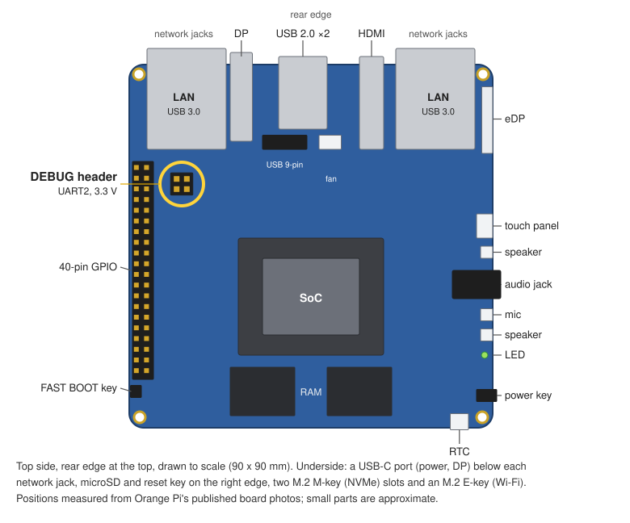
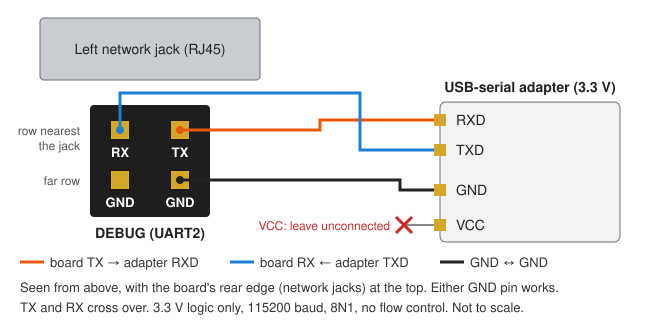

# Installing the open GPU stack on an Orange Pi 6

This guide is for the **Orange Pi 6 (non-Plus)**: a 90x90 mm board with a CIX P1 (CD8180), a Mali-G720 and 2x RTL8125.
The end result runs Armbian userspace on a mainline-based 6.18 kernel, with the **panthor** GPU driver and Mesa
(**panvk** Vulkan 1.4, **Panfrost** GLES 3.1). It uses no vendor kernel and no closed Mali blobs. Armbian's own
kernel stays installed as an automatic fallback.

Time needed: about 15 minutes of hands-on work, plus 20-60 minutes of unattended kernel build.

## 0. What you need
- An Orange Pi 6 (non-Plus) with an NVMe SSD and the official 20 V Type-C PD power supply (the BIOS manual recommends 100 W)
- A monitor and USB keyboard for the firmware steps (or a 3.3 V USB-serial adapter, see the end of this guide)
- Wired network

## 1. Update the board firmware (if it shipped with V0.8)
Check the version: in firmware setup (press **Esc** or **F2** at power-on) or under Linux, `cat /sys/class/dmi/id/bios_version`.

If it says `OPI6BiosV0.8...` (April 2026), update it. With that firmware's default memory speed (6400 MT/s), our
board logged **1,227 corrected and 1 uncorrectable DDR ECC errors in 3 minutes** of memory stress on stock Armbian, and
reset itself under load. With the 2026-10-19 firmware, the same board ran a **4-hour combined CPU+RAM+GPU stress at
6400 with zero errors** (see `bench/MEMORY-AB-REPORT.md`).

1. Download `opi6_bios_image_20261019.img` (or newer) from orangepi.org → Orange Pi 6 → Download → **BIOS**.
   If Google Drive says "quota exceeded", use "Make a copy" and download the copy.
2. The `.img` holds a FAT32 partition with `bios_flash/FlashUpdate.efi` and `bios_flash/bios_v1.0.bin` (the Linux
   build). Copy those two files to any FAT32 USB stick, or to the EFI partition of an installed system
   (`/boot/efi/bios_flash/`).
3. Power on and press **Esc** → **Boot Manager** → **UEFI Shell**.
4. `fs0:` then `ls`. If `bios_flash` isn't listed, try `fs1:`, `fs2:` and so on. Then `cd bios_flash`.
5. `FlashUpdate.efi -f bios_v1.0.bin`. It shows the old and new versions, flashes, and **reboots by itself**.
   Don't cut the power while it runs.

## 2. Firmware settings
In setup (**Esc**): CIX System Manager → Soc Configuration → **Memory Configuration** → **Memory Data Rate**.
- On the 2026-10-19 firmware, `Auto` (6000 MT/s) or `6400` are both fine. We measured no speed difference for CPU, GPU or LLM work.
- If you're stuck on V0.8, set **5500 MT/s**. That was error-free on our board.

Save & Exit with **F10**, then **Y**, and let the board boot.

**No RTC battery?** The board ships without one. Then every power loss resets these settings: memory speed goes back to
`Auto` (6000) and "power on after power loss" goes back to off. The board has a 2-pin 1.0 mm **JRTC1** header with
no holder, and it doesn't charge the cell: fit a plain **CR2032** with an SH1.0 (JST 1.0 mm) 2-pin lead, observing
polarity. Until then, don't cut the power right after saving a setting.

## 3. Install Armbian
Install the generic **Armbian UEFI arm64** image (we used Armbian 26.8.3 "resolute", Ubuntu 26.04 userspace)
onto the NVMe the usual way, boot it, and get on the network.

## 4. Run the setup script
```bash
sudo apt-get install -y git
git clone https://github.com/jbuck2005/orangepi6
cd orangepi6
scripts/setup.sh
```
`setup.sh` checks the board and firmware, installs the build tools and Mesa from the Ubuntu archive, fetches Linux
6.18.64 (the version in `kernel.conf`) from kernel.org (and checks Greg Kroah-Hartman's signature), applies the Sky1-Linux patches and this repo's
non-Plus device tree, and builds the kernel (`-j6`, 20 minutes to an hour). It then installs the kernel into `/boot/sky1/`
and makes it the GRUB default. Every step is checked, and the script stops with a clear message on the first failure.
Re-running it skips steps that are already done.

**No time to build?** `scripts/setup.sh --prebuilt` downloads the ready-to-run kernel from this repo's GitHub
Releases instead. It's built by exactly this process, and its SHA-256 is checked against the release's `SHA256SUMS`.
That saves the hour. The matching patched kernel source is published next to it.

**Prefer packages?** The same kernel (and the NPU library) also comes as `.deb` packages that install with
`sudo apt install ./orangepi6-kernel-6.18_*_arm64.deb`, and upgrade and remove like any other package. See
[docs/packages.md](docs/packages.md).

Then:
```bash
sudo reboot
scripts/setup.sh check        # panthor, /dev/dri/renderD128, Vulkan = panvk, GLES = Panfrost
scripts/gpu-test.sh           # optional: vulkaninfo, glmark2, vkmark
```

### Optional: kernel 7.3.5 instead of 6.18.64
The repo has two kernel tracks (see `kernel.conf`). **6.18.64 LTS is the default** and the most tested. **7.3.5** is
kernel.org 7.3.5 with this repo's forward port of the Sky1 patches (`patches/7.3/`). It performs the same as 6.18.64
on the GPU and the CPU, but has had much less time on the board (see `docs/KERNEL-7.md` and the release notes of
v2026.11.22). To install it, put `KERNEL_TRACK=7` in front of the setup command:
```bash
KERNEL_TRACK=7 scripts/setup.sh --prebuilt     # or KERNEL_TRACK=7 scripts/setup.sh to build it (about 25 min)
sudo reboot
scripts/setup.sh check                         # remembers the track; no prefix needed
```
Only one sky1 kernel is installed at a time; Armbian's kernel stays entry 0 either way. To switch an installed board
between the tracks, boot Armbian's kernel, then run `FORCE=1 KERNEL_TRACK=7 scripts/setup.sh --prebuilt` (or
`KERNEL_TRACK=6.18` to go back), reboot, and run `scripts/setup.sh check`. On 7.3.5 the CIX display drivers are off
(they don't build on 7.x yet); the board runs headless and the GPU is not affected.

### Optional: the NPU
Kernels built from this repo carry CIX's 6.2.0 NPU driver. On the sky1 boot, `scripts/setup.sh npu` builds and
installs Arm China's open NPU library (`libaipudrv` 4.1.0, into `/usr/local`) and `npu-run`, and prints what the NPU
reports. Compiled models come from CIX's model hub; see [docs/npu.md](docs/npu.md). No firmware is needed. The 6.18.64
releases v2026.11.22.1 and v2026.11.23 have it; the earlier releases, and the 7.3.5 pre-release v2026.11.22, have the older driver,
which the library does not work with (build 7.3.5 from source for the NPU).

## How the fallback works
- Armbian's kernel stays entry 0 in GRUB. The sky1 kernel lives separately in `/boot/sky1/`, so Armbian kernel
  updates don't touch it.
- GRUB marks every sky1 boot as pending (`sky1_pending=1` in grubenv), and `sky1-boot-report.service` clears the
  mark once the system is up. If GRUB finds the mark still set (a hang, panic or power loss before boot finished),
  it boots **Armbian** instead and sets `sky1_failed=1`. Armbian then stays the default until you run
  `sudo WORK=~/sky1-build scripts/install.sh default` again.
- `scripts/install.sh undefault` makes Armbian the default for good.
- `scripts/install.sh bootlog` shows the GRUB markers and the raw early-boot log of the last sky1 boot.

## Known issues
- **Network ports missing after a reboot (fixed by the `r8169` default):** with Realtek's `r8125` driver
  (`NIC_DRIVER=r8125` builds), every warm reboot from the sky1 kernel makes the firmware fail PCIe link training for
  the RTL8125s (`ip -br link` shows only `lo`; the serial console shows `Root Port 2/3: Link Up Fail,Ltssm State:40C80`).
  The state `r8125` sets in the chip when it loads survives the reset. The sky1 kernel now uses `r8169`, which
  doesn't do this. A second warm reboot usually recovers; otherwise cut the power for about 30 s. To automate that, put the board on a smart plug with a local HTTP API (Shelly Gen2+/Gen3
  with its cloud switched off, or a Tasmota plug) and run `tools/plug-watch.ps1` on the PC that logs the serial
  console: it power-cycles the board when the firmware reports the failure (at most 3 times an hour), and
  `-Once` does a cycle by hand. `tools/plug-powercycle.sh` does a single cycle from Linux. The plug's address
  and password live in a JSON file outside the repo. With **Home Assistant** (any plug HA can switch), create a long-lived
  access token and use `{"type":"homeassistant","url":"http://<ha>:8123","entity":"switch.<plug>","token_file":"<file>"}`
  (the file holds just the token, chmod 600; or add `"token_var":"HA_TOKEN"` to read one variable from an env file):
  the watcher calls `switch.turn_off`, waits 30 s, then `switch.turn_on`, retrying for up to 10 minutes and
  logging loudly if the plug doesn't come back on. **Fit an RTC battery first** (CR2032 on the `JRTC1` lead):
  without one, every power cut resets the firmware settings, so memory drops back to its default speed and the
  "power on after AC loss" setting turns off, and the board then stays off after the plug comes back on. (`scripts/nic-power.sh`, which switches the NIC rails
  through GPIO038/039, is experimental: it froze the board under Armbian.)
- **Cool the NVMe SSD.** On a bare board the M.2 slot gets no airflow. Under heavy disk load (a full kernel build)
  the controller of a heatsink-less SSD reached 97-100 C on our board, and we saw a hang and a kernel panic during
  such builds. With a small fan blowing across the SSD it stayed around 50 C and an 8-hour build-and-memory-stress
  run passed. `nvme smart-log /dev/nvme0` shows the sensors; the composite value can look fine while "Sensor 1"
  (the controller) is far hotter. Fit an M.2 heatsink or give the SSD some airflow.
- **LLMs on the GPU:** llama.cpp's Vulkan backend on panvk generates text at only ~1.7 tok/s, and prompt processing
  fails with `ErrorOutOfDeviceMemory`. Use the CPU for now: Qwen2.5-1.5B Q4 runs at ~124 tok/s for prompts and ~37 tok/s
  for generation, and 7B at ~34/9 tok/s. In a Vulkan build, pass `-dev none`.
- **panvk** is not yet a conformant Vulkan driver. GPU temperature sensors don't read.
- Only with an `r8125` build: that driver can't read the NICs' MAC addresses, so `stage` pins the real MACs from
  Armbian. **Run `stage` from Armbian's kernel** (`setup.sh` checks this).
- **2.5 Gbit/s:** reports put `r8125` ahead of `r8169` at 2.5 Gbit/s (it spreads traffic over several cores). At
  1 Gbit/s `r8169` reaches line rate. If you need full 2.5 G throughput and can live with the reboot issue, build with
  `NIC_DRIVER=r8125`.

## Debug serial console (optional)
The **2x2 "DEBUG" header** sits just below the left network jack. The row nearest the jack is RX (left) and TX
(right), and the far row is GND. It's UART2: 3.3 V, 115200 8N1. Connect adapter TX to board RX and adapter RX to
board TX, and leave the adapter's VCC unconnected. The firmware, GRUB and the sky1 kernel all log there.
`scripts/install.sh arm acpi` with `SERIAL=1` arms a one-time test boot that keeps all output on the serial console.
`bench/serial-log.ps1` is a timestamping logger for Windows.

<p>
  
  
</p>

## Benchmarks
`bench/` holds the A/B suite (`ab-test.sh`), the combined soak (`soak.sh`) and the results from our board.
