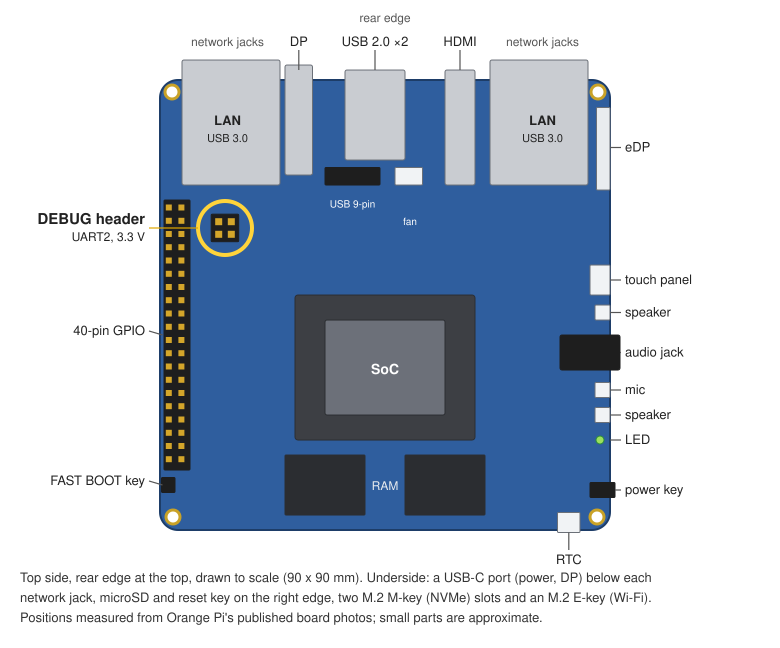
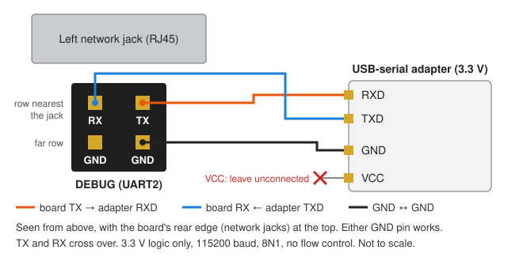

# orangepi6

An open, low-effort Linux install for the **Orange Pi 6** (standard, non-Plus: 90x90 mm board, CIX P1 / CD8180,
Mali-G720, 2x RTL8125), on stock Armbian with a mainline-based kernel and fully open GPU drivers.

- **Base OS:** stock Armbian generic **UEFI arm64** image (Ubuntu 26.04 "resolute" userspace) on an NVMe SSD.
- **Kernel:** Linux **6.18.64** (6.18 LTS) from kernel.org plus the
  [Sky1-Linux/linux-sky1](https://github.com/Sky1-Linux/linux-sky1) patches (commit `57e018a`; the 5 that needed
  rebasing for 6.18.64, and 4 fixes of our own, are in [patches/6.18.64/](patches/6.18.64/)). It boots in the
  firmware's **ACPI** mode. The version is set in [kernel.conf](kernel.conf). This is the default.
- **Kernel 7 (optional):** Linux **7.3.5** from kernel.org with this repo's forward port of the Sky1 patches
  ([patches/7.3/](patches/7.3/), [docs/KERNEL-7.md](docs/KERNEL-7.md)). Install it with `KERNEL_TRACK=7`. It matches
  6.18.64 on the GPU and on the CPU, but it has had far less testing; see [Known issues](#known-issues).
- **GPU:** mainline **panthor**, with Mesa from Ubuntu 26.04: **panvk** (Vulkan 1.4) and **Panfrost** (GLES 3.1).
  No CIX vendor kernel and no closed Mali (`mali_kbase` / `libmali`) stack.
- **Safe by default:** Armbian's own kernel stays installed as GRUB entry 0 and as an automatic fallback.
- **Releases:** [v2026.11.22.1](../../releases/tag/v2026.11.22.1) (6.18.64 LTS with the NPU driver, the default) and
  [v2026.11.22](../../releases/tag/v2026.11.22) (7.3.5, pre-release, old NPU driver). Each has a prebuilt kernel and its exact source.

This repo is for the **standard Orange Pi 6 only**. Don't use the Plus device tree (`sky1-orangepi-6-plus.dtb`) on it.

## Quick start
The full guide, with every firmware step, is [INSTALL.md](INSTALL.md). In short:

1. **Update the board firmware** to `opi6_bios_image_20261019` (or newer) if it shipped with V0.8.
   See [Firmware and BIOS](#firmware-and-bios).
2. **Install Armbian** (generic UEFI arm64, Ubuntu 26.04) on the NVMe, boot it and get on the wired network.
3. **Run the setup script** from Armbian:
   ```bash
   sudo apt-get install -y git
   git clone https://github.com/jbuck2005/orangepi6 && cd orangepi6
   scripts/setup.sh --prebuilt     # or scripts/setup.sh to build from source (20-60 min on the board)
   sudo reboot
   scripts/setup.sh check          # panthor, /dev/dri/renderD128, Vulkan = panvk, GLES = Panfrost
   ```

Hands-on time is about 15 minutes. `--prebuilt` downloads the release kernel and checks it against the release's
`SHA256SUMS`; the source path fetches kernel.org 6.18.64, checks its signature, patches it strictly (no fuzz) and
builds it on the board. Either way the kernel goes into `/boot/sky1/` and every step is verified (`install.sh verify`).

For kernel 7.3.5 instead, put `KERNEL_TRACK=7` in front of the setup command:
`KERNEL_TRACK=7 scripts/setup.sh --prebuilt` (or without `--prebuilt` to build it). The choice is remembered, so
`scripts/setup.sh check` needs no prefix. To switch an installed board between 6.18 and 7, boot Armbian's kernel and
run `FORCE=1 KERNEL_TRACK=<6.18|7> scripts/setup.sh --prebuilt`. Only one sky1 kernel is installed at a time.

## Firmware and BIOS
Firmware setup opens with **Esc** (or **F2**) at power-on. Check the installed version there or from Linux with
`cat /sys/class/dmi/id/bios_version`.

- **Use firmware `opi6_bios_image_20261019`** (`bios_v1.0.bin`, from orangepi.org > Orange Pi 6 > Download > BIOS),
  flashed with `FlashUpdate.efi` from the UEFI Shell ([INSTALL.md step 1](INSTALL.md#1-update-the-board-firmware-if-it-shipped-with-v08)).
  The shipped **V0.8** firmware (April 2026) was unstable at its default 6400 MT/s: 1,227 corrected and 1
  uncorrectable DDR ECC errors in 3 minutes of stress, and resets under load.
- **Memory speed:** Esc > **CIX System Manager** > **Soc Configuration** > **Memory Configuration** >
  **Memory Data Rate**. On the 2026-10-19 firmware, `Auto` (6000 MT/s) and `6400` both passed 1 h of combined
  build + `stress-ng` load on 6.18.64 with 0 ECC errors and 0 resets (and an earlier 4 h CPU+RAM+GPU soak at 6400).
  We measured no speed difference for CPU, GPU or LLM work. If you're stuck on V0.8, use 5500.
- Then **Save & Exit** (F10, then Y) and let the board boot. Don't cut the power right after changing a setting:
  without an RTC battery (below), a power cut loses it.

## RTC battery
The board ships **without an RTC battery**, so every AC power loss resets the firmware settings: memory speed goes
back to `Auto` (6000) and "power on after power loss" goes back to off, so the board stays off after a power cut.

The board has a 2-pin **1.0 mm JRTC1** header with no battery holder, and the circuit does **not** charge the cell
(it's diode-fed). Fit a plain **CR2032** with an **SH1.0** (JST 1.0 mm) 2-pin lead, observing polarity. Don't use a
rechargeable cell. Until one is fitted, set the memory speed and power-loss behavior again after every power loss.

## Hardware notes
- **Network:** both RTL8125B 2.5 GbE ports use the mainline `r8169` driver, built into the sky1 kernel (as in
  Armbian's kernel), with the `rtl_nic/rtl8125b-2.fw` firmware from linux-firmware. Realtek's own `r8125` is still
  available (`NIC_DRIVER=r8125` for `02-fetch-patch.sh`), but with it every warm reboot loses both ports until a
  power cut, and it can't read the MACs in ACPI mode (`stage` then pins them with `.link` files). Trade-off:
  reports put `r8125` ahead at 2.5 Gbit/s (it spreads traffic over several cores); at 1 Gbit/s `r8169` reaches line
  rate (941 Mbit/s each way on our board). Full write-up: [docs/nic-r8125-vs-r8169.md](docs/nic-r8125-vs-r8169.md).
- **NVMe / PCIe:** the Sky1 PCIe driver could hit an **AER interrupt storm** on the NVMe root port (`sky1-pcie.2`)
  right after PHY bring-up, which caused silent resets under load. `post/0003` and `post/0004` fix it (spurious
  interrupts return `IRQ_NONE`, the line is disabled after 64 in a row, and latched local errors are cleared).
- **Power draw at the wall** (including the supply): ~1 W off, ~17 W idle, 30-36 W under build or stress load.
- **Power supply:** the official 20 V USB-C PD supply (the BIOS manual recommends 100 W).

## Results on our board
| | |
|---|---|
| GPU | panthor 1.5.0, Mali-G720 MC10, CSF firmware v3.13, Mesa 26.0.8 |
| Vulkan (vkpeak) | FP32 1.20 TFLOPS, FP16 2.11 TFLOPS, INT8 dot 4.86 TOPS |
| glmark2-es2-drm (off-screen) | 1591 |
| vkmark (headless) | 3460-3544 (llvmpipe: 741) |
| llama.cpp CPU, Qwen2.5-1.5B Q4_K_M | 124 tok/s prompt, 36.6 tok/s generation |
| llama.cpp CPU, Qwen2.5-7B Q4_K_M | 33.7 / 8.75 tok/s |
| NPU, CIX MobileNetV2 (s8) | 1.58 ms per run, 631 runs/s (`npu-run bench`, 6.18.64) |
| Memory stability | firmware 2026-10-19: 0 ECC errors at 5500/6000/6400 MT/s; 1 h load at 6000 and 6400 on 6.18.64 |

Details: [bench/MEMORY-AB-REPORT.md](bench/MEMORY-AB-REPORT.md) and [STATUS.md](STATUS.md).

## Known issues
- **Network ports missing after a warm reboot (fixed):** with Realtek's `r8125` driver, every warm reboot from the
  sky1 kernel made the firmware fail PCIe link training for both RTL8125s (`ip -br link` shows only `lo`, even on
  Armbian) until a 30 s power cut. The sky1 kernel now uses `r8169`, which doesn't do this. If you still see it
  (for example after an `r8125` build), a second warm reboot or a power cut recovers.
- **LLMs on the GPU:** llama.cpp on panvk is slow (~1.7 tok/s) and prompt processing fails with
  `ErrorOutOfDeviceMemory`. Use the CPU (`-dev none` in a Vulkan build).
- **panvk** is not yet a conformant Vulkan driver, and the GPU temperature sensors don't read.
- **Kernel 7 (7.3.5) is optional and less tested than 6.18.64.** GPU and CPU performance match 6.18.64 (the CPU
  scheduling gap is fixed by `0055`, see [docs/kernel7-cpu-scheduling.md](docs/kernel7-cpu-scheduling.md)), but:
  - the final build has been booted once; earlier builds of the same track passed a 1 h load test;
  - the fix for the PCIe AER interrupt storm on 7.x (`0053`) has been quiet on every boot since, but no boot has yet
    shown the storm it was written for;
  - the CIX display drivers do not build on 7.x and are off (the board runs headless; the GPU is unaffected);
  - two debug patches (`0050`, `0051`) are still in the series: they add a few log lines on each reboot and a
    register dump if an AER line is ever cut off.

## Debug serial console
The **2x2 "DEBUG" header** just below the left network jack is UART2: 3.3 V, **115200 8N1**. The row nearest the
jack is RX (left) and TX (right); the far row is GND. Cross TX/RX to a 3.3 V USB-serial adapter and leave its VCC
unconnected. The firmware, GRUB and the sky1 kernel all log there. The firmware has no SPCR table, so serial test
boots (`SERIAL=1 scripts/install.sh arm acpi`) use `earlycon=pl011,mmio32,0x040d0000`.
`bench/serial-log.ps1` is a timestamping logger for Windows.

<p>
  
  
</p>

## Roadmap
- **Phase 1, GPU:** done (2026-11-18), released as v2026.11.19 and v2026.11.19.1.
- **Kernel 7:** 7.3.5 merged as an optional track on 2026-11-22 and released as v2026.11.22 (pre-release).
- **Phase 2, NPU:** working on an open stack (CIX's 6.2.0 driver, Arm China's open `libaipudrv` 4.1.0), see
  [docs/npu.md](docs/npu.md). Released in v2026.11.22.1 (6.18.64).
- Ruled out: the CIX/Canonical vendor kernel and closed Mali stack, NCZ-OS, and the original Orange Pi vendor image
  (it didn't boot on this board). See [HISTORY.md](HISTORY.md).

## History
[HISTORY.md](HISTORY.md) records every patch, change, release and finding to date, in order. It is updated with every
change (see [CONTRIBUTING.md](CONTRIBUTING.md)).

## Layout
| Path | What |
|---|---|
| `scripts/setup.sh` | one-command install from stock Armbian (preflight, packages, source, build, stage, default, check); `--prebuilt` uses the release |
| `scripts/02-fetch-patch.sh`, `03-build.sh` | kernel source (signature checked), Sky1 patches, our DTS, config; build at `-j6` |
| `scripts/install.sh` | `stage`, `verify`, `default`/`undefault`, one-time test boots (`arm acpi\|dt`, `disarm`), `bootlog`, `prune` |
| `scripts/boot-report.sh` | confirms the default boot (clears GRUB's fallback mark); network fallback for test boots |
| `scripts/gpu-test.sh` | vulkaninfo, glmark2 and vkmark, results to `/var/log/sky1-gpu-test.txt` |
| `scripts/package-release.sh` | builds the release tarballs and `SHA256SUMS` |
| `kernel.conf` | the two kernel tracks (`KERNEL_TRACK=6.18`, the default, or `7`): version and patch set used by every script |
| `patches/6.18.64/` | rebased Sky1 patches; `post/` holds our fixes (syscore API, r8125 netpoll, AER storm, NPU driver 6.2.0) |
| `patches/7.3/` | kernel 7 track: the Sky1 patches forward-ported to 7.3.5, plus our fixes (`0044`-`0055`) |
| `docs/` | kernel 7 notes and board results (`KERNEL-7.md`), the CPU scheduling fix, r8125 vs r8169, the NPU (`npu.md`) |
| `initramfs/`, `scripts/bootlog-area.sh` | early-boot logger: writes the kernel log to a raw disk area before root is mounted |
| `dts/sky1-orangepi-6.dts` | non-Plus device tree (for the optional DT/`acpi=off` route) |
| `bench/` | benchmark and memory-soak suite, Windows UART logger, A/B report |
| `tools/` | netconsole listener and self-test; read-only smart-plug power report (`plug-power.py`); `npu-run` and `npu-prep.py` |
| `scripts/npu-umd.sh` | builds and installs Arm China's open NPU library (`libaipudrv` 4.1.0); `setup.sh npu` runs it |
| `scripts/01-toolchain.sh` | unprivileged toolchain from Ubuntu debs (only needed without root; `setup.sh` uses apt instead) |

## How the fallback works
GRUB marks every sky1 boot as pending, and `sky1-boot-report.service` clears the mark once userspace is up. If the
mark is still set at the next boot (a hang, panic or power loss), GRUB boots **Armbian** instead and keeps it as the
default until you run `scripts/install.sh default` again. `scripts/install.sh undefault` makes Armbian the default
for good. GRUB changes are generated into a temp file and checked (`grub-script-check`, Armbian is still entry 0)
before they're installed.

## Safety and verification
`install.sh verify` fails loudly if anything is missing or mismatched. It checks the module tree and panthor
vermagic for the exact release, the built-in boot and network drivers, that `/boot/sky1` matches the build, the DTB
model, that the initrd's tools run inside the initrd with nothing leaked from the build environment, the boot logger
(by a self-test with the initrd's own `dd`), the NIC MAC pins, and the Mali firmware.

## Device-tree route
With the Sky1 patches, the GPU is powered through SCMI in ACPI mode, so the `acpi=off` + device-tree route
documented for the Plus isn't needed. It's still available as a one-time test boot: `install.sh arm dt`.
