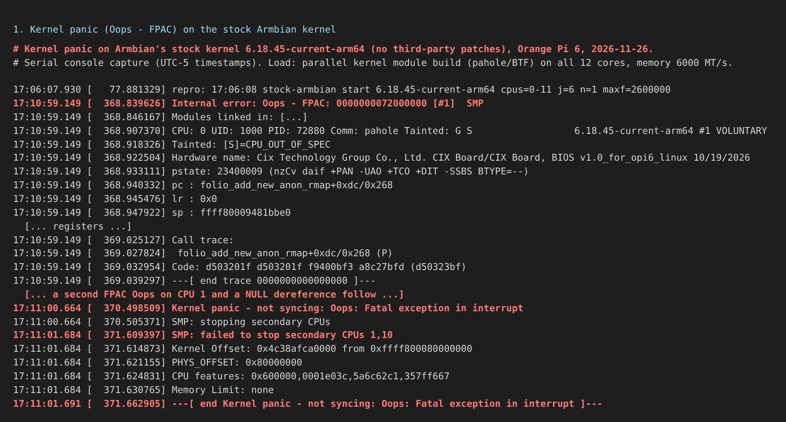
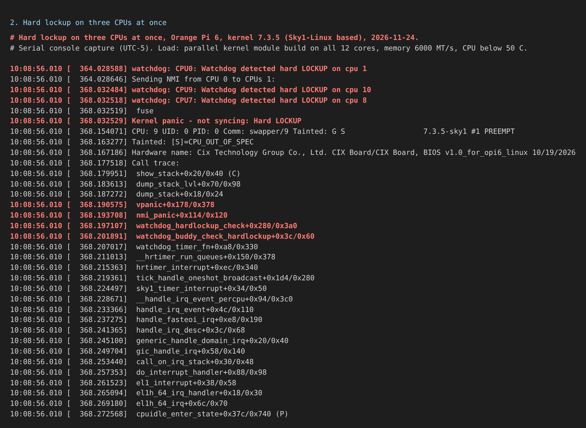
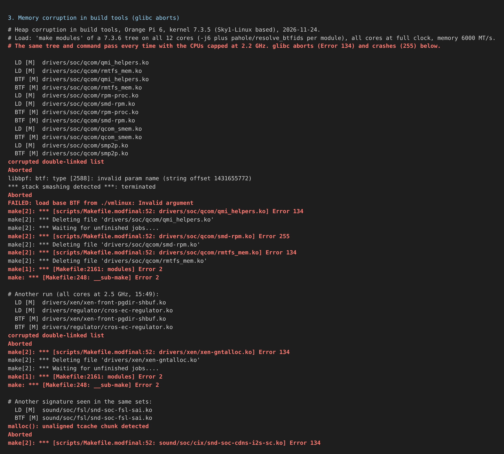
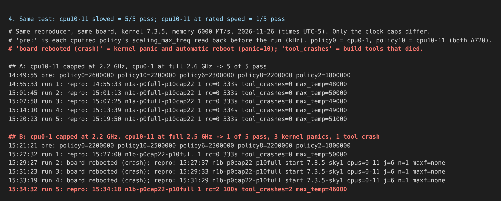

# Evidence: CPU pair cpu10-11 unstable at rated clock (2026-11-28)

A short summary of the full-load crash on one standard Orange Pi 6 (CIX P1 / CD8180), for a warranty or return
claim. The full investigation, with every test set, is in [CRASH-ANALYSIS.md](CRASH-ANALYSIS.md).

## Summary

- **Fault.** With all 12 cores busy (a parallel kernel module build), the board corrupts memory within 1 to 5
  minutes. It shows up as build tools aborting on heap corruption, kernel Oopses, hard lockups and kernel panics.
- **Stock setup.** It happens with the manufacturer's USB-C power adapter, the latest Orange Pi firmware
  (2026-10-19), memory at the firmware's default 6000 MT/s, the CPU below 57 C, and Armbian's own unmodified kernel
  (6.18.45, 4 of 5 runs failed).
- **Located to one core pair.** The fault follows one pair of A720 cores, cpu10-11 (cpufreq policy10, rated
  2.5 GHz). With that pair slowed and every other core at full clock, the board passes; with that pair at its rated
  clock and the others slowed, it fails (image 4).
  - At 2.45 GHz and above, cpu10-11 failed 10 of 15 runs.
  - At 2.4 GHz, below its rating, it passed 64 of 65 runs: 45 of 45 on kernel 7.3.5 and 19 of 20 on kernel 6.18.64
    (2026-11-28; the one failure was a build tool crash).
  - The other big pair, cpu0-1, runs clean at its full 2.6 GHz.
- **Ruled out.**
  - The power supply: an A-B-A swap with a 65 W supply failed the same way.
  - The memory rate: it fails at both 5500 and 6000 MT/s.
  - Heat: it fails with the CPU below 50 C.
  - Our kernel: Armbian's stock kernel fails too.
  - Other causes: deep idle states, the HDA driver, and missing CPU errata workarounds in the firmware.
  - Memory testers (`stress-ng --verify`, `memtester`) pass; only this mixed build load triggers it.
- **Conclusion.** One core pair on this unit is not stable at its rated clock, and not fully stable 4% below it.
  The firmware has no voltage or clock settings to work around it. This is reported to CIX as
  [cixtech/bios#7](https://github.com/cixtech/bios/issues/7).

## Images

Text excerpts from the serial console and the test logs, rendered as images. Each one has its text file next to
it in [rma-evidence/](rma-evidence/).

**1. Kernel panic (Oops - FPAC) on Armbian's stock kernel 6.18.45** ([text](rma-evidence/01-panic.txt))



**2. Hard lockup on three CPUs at once, kernel 7.3.5** ([text](rma-evidence/02-lockup.txt))



**3. Memory corruption in the build tools (glibc aborts)** ([text](rma-evidence/03-heap.txt))



**4. Same test, only the clock caps changed: cpu10-11 slowed passes 5 of 5, cpu10-11 at rated clock passes 1 of 5**
([text](rma-evidence/04-runs.txt))



## Workaround

Cap cpu10-11 at 2.4 GHz (until the next boot, either kernel track):

```
echo 2400000 | sudo tee /sys/devices/system/cpu/cpu{10,11}/cpufreq/scaling_max_freq
```

For no failure seen at all so far, cap all four big cores (cpu0, 1, 10 and 11) at 2.2 GHz instead.
